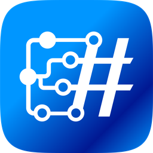
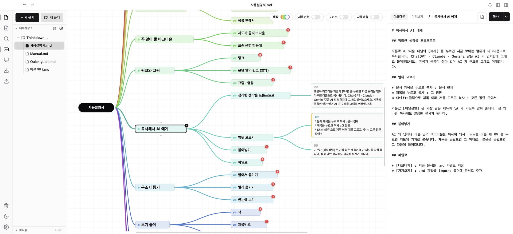
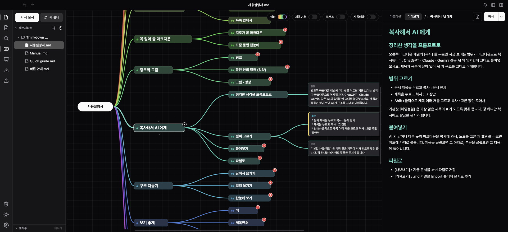
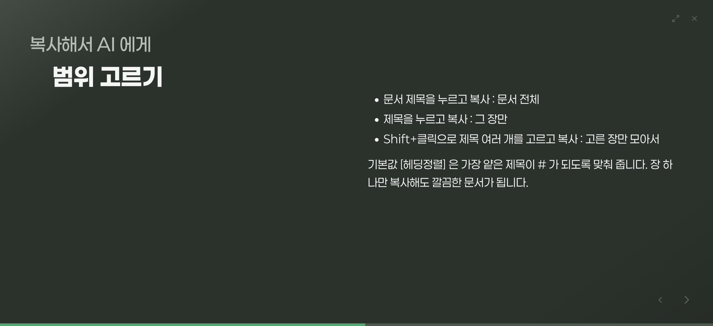

<div align="center">



# Thinkdown

### Think it down to mark it down.

복잡한 생각은 맵으로 가볍게, AI 프롬프트와 글 초안은 정교하게.

[](https://github.com/mcnorton/thinkdown/releases/latest)


**[⬇︎ 내려받기](#내려받기)** · [사용법](https://www.thinkdown.net/guide.html) · [홈페이지](https://www.thinkdown.net/) · [English](README.en.md)

</div>



<p align="center"><sub>생각을 마인드맵으로 펼치면 오른쪽에 마크다운 문서가 생기고, <code>F5</code> 를 누르면 그대로 발표 화면이 됩니다.</sub></p>

## 이런 순간, 있지 않으셨나요

**AI 채팅창의 커서가 깜빡입니다.** 만들고 싶은 화면도, 규칙도, 예외도 머릿속에 다 있는데 —
무엇부터 말해야 할지 모르겠습니다. 결국 생각나는 대로 치고, 중요한 이유 하나를 빠뜨립니다.

**하얀 에디터가 열려 있습니다.** 쓰고 싶은 이야기는 분명 있는데, 첫 문장이 정해지지 않으면
아무것도 시작되지 않습니다. 글쓰기가 어려운 게 아니라, 순서를 먼저 정해야 하는 게 어렵습니다.

생각은 원래 순서 없이 떠오릅니다. Thinkdown은 생각을 꺼내는 가장 자유로운 방식인 **마인드맵**과,
남에게 전하는 가장 정돈된 형태인 **글** 사이의 벽을 없앴습니다. **맵이 곧 문서**라서 옮겨 적는
단계가 없습니다. 떠오르는 대로 꺼내 놓고 나중에 자리를 잡아 주면, 순서는 그때 생깁니다.

## 이렇게 쓰입니다

- **AI가 한 번에 알아듣는 프롬프트** — 가운데에 만들 것을 적고, 화면 · 로직 · 예외 조건으로
  가지를 뻗습니다. 오른쪽에는 제목과 항목이 갖춰진 마크다운 프롬프트가 이미 있어서, **[복사]**
  한 번으로 AI 채팅창에 붙여넣습니다. 왜 그렇게 만들어야 하는지까지 빠짐없이 전해집니다.
- **첫 글쓰기가 막막할 때** — "글 말고, 생각나는 걸 상자로 만들어 봐." 단어와 짧은 문장을
  늘어놓고 상자를 블록처럼 끌어다 묶다 보면 처음 · 가운데 · 끝이 저절로 생깁니다.
  오른쪽에는 소제목과 문단을 갖춘 초안이 이미 있습니다.
- **기획서 · 회의록 · 강의 노트** — 큰 덩어리부터 잡고 안을 채웁니다. 말이 튀는 대로 가지에
  붙여 두고, 끝나면 트리만 정리해 그대로 공유합니다.

## 네 걸음이면 됩니다

| | |
|---|---|
| **1. 툭툭 꺼내기** | `Tab` 은 한 단계 아래, `Enter` 는 같은 층. 마우스 없이 떠오르는 속도 그대로 적습니다. 단어가 아니라 문장도, 긴 문단도 괜찮습니다. |
| **2. 쓱쓱 엮기** | 상자를 다른 상자 위에 놓으면 그 아래로, 사이에 놓으면 순서가 바뀝니다. 챕터를 통째로 옮겨도 제목 단계는 알아서 맞춰집니다. |
| **3. 바로 거두기** | 오른쪽에는 이미 글이 있습니다. 내보내기도 변환도 없이 **[복사]** 한 번. 챕터를 누르면 그 부분만 골라 가져갑니다. |
| **4. 펼쳐 보여 주기** | `F5` 를 누르면 지금 문서가 그대로 슬라이드쇼가 됩니다. 슬라이드를 따로 만들 시간에 할 말을 다듬으세요. |

맵을 만드는 동안 오른쪽에는 이런 마크다운이 저절로 쓰여 있습니다.

```markdown
# 역할

당신은 시니어 코드리뷰어입니다. 변경된 코드만 읽고, 실제로 깨지는 문제를 먼저 보고합니다.

# 입력

- 변경 diff와 대상 브랜치
- 테스트 실행 결과

# 출력 형식

| 항목 | 내용 |
| --- | --- |
| 심각도 | high / medium / low |
| 위치 | 파일:줄 |
```





## 그 밖에

- 문단 · 목록 · 인용 · 코드 · 표 · 이미지 · 링크 등 **표준 마크다운 본문 9종** — 표는 칸을 직접 채우고, 링크는 제목과 썸네일이 붙은 카드로 보입니다
- 챕터가 많으면 좌우로 펼치는 **나비날개형** 등 여러 배치 형태
- **폴더**로 묶고, **검색**하면 그 문장이 있는 자리로 바로 이동
- 한글 입력이 깨지거나 겹치지 않도록 세 운영체제 모두에서 다듬음
- 색상 테마와 **다크 모드**, 장마다 다른 알록달록한 색상
- 마음껏 바꿔 보고 **되돌리기** · 지운 문서는 **휴지통**에서 다시 꺼내기
- 문서 전체를 **.zip 하나로 백업**하고 새 컴퓨터에서 복원 · 문서 하나는 **.md** 로 가져오기/내보내기
- 새 버전은 작업 끊김 없이 받아 두었다가 다시 시작할 때 업데이트 — 그 전에 문서를 자동으로 백업해 둡니다

## 요금제

**기능은 모두 무료입니다.** 문서 · 폴더 · 검색 · 가져오기와 내보내기 · 백업 · 슬라이드쇼, 그리고
앞으로 추가되는 기능까지 계정도 로그인도 없이 마음껏 쓰실 수 있습니다.

**Gift 🎁** — 도움이 되셨나요? 개발자에게 [커피 한 잔](https://buymeacoffee.com/mcnorton)을,
소중한 당신에게는 감사의 선물을 드립니다. 후원 한 번에 기기 3대까지, 평생 열립니다.

- 🎁 색상 테마 서울풍경 · 한국궁궐
- 🎁 배치 형태 열매나무형 · 뿌리채소형
- 🎁 사용자 지정 글꼴

> 📣 **베타 기간 이벤트 : 열려라 선물상자** — 베타가 끝날 때까지 🎁 선물을 모두에게 열어 둡니다.
> 후원자가 앱에서 선물을 받는 기능은 준비 중입니다.

## 내려받기

**[⬇︎ 최신 릴리스에서 내 운영체제용 파일 받기](https://github.com/mcnorton/thinkdown/releases/latest)**

| 운영체제 | 받을 파일 | 설치 |
|---|---|---|
| **macOS** 13 이상 — Apple Silicon(M1 이상) | `Thinkdown-<버전>-arm64.dmg` | 열어서 **Thinkdown**을 응용 프로그램 폴더로 드래그 |
| **macOS** 13 이상 — Intel | `Thinkdown-<버전>-x64.dmg` | 위와 같습니다 |
| **Windows** 10 · 11 (64비트) | `Thinkdown-Setup-<버전>.zip` (또는 `.exe`) | 압축을 풀고 `Thinkdown-Setup`을 실행 — 관리자 권한이 필요 없습니다 |
| **Linux** (64비트) | `Thinkdown-<버전>.AppImage` 또는 `.deb` | AppImage는 `chmod +x` 후 실행, deb는 `sudo dpkg -i` |

- 내 Mac의 칩은 **Apple 메뉴 → 이 Mac에 관하여**에서 볼 수 있습니다. "Apple M…"이면 arm64, "Intel"이면 x64입니다.
- macOS 빌드는 Apple의 서명·공증을 받아 경고 없이 바로 열립니다.
- macOS 11 · 12 에서는 v0.22.100 이 마지막 버전입니다.

<details>
<summary><b>Windows에서 경고 화면이 뜬다면</b></summary>

<br>

설치 파일은 코드 서명되어 있어 설치 화면에 게시자 이름(**McNorton&Education**)이 표시됩니다.
다만 서명을 시작한 지 얼마 되지 않아 평판이 쌓이기 전까지는 **SmartScreen 경고**가 뜰 수 있습니다.
이때는 **추가 정보 → 실행**을 누르면 설치됩니다.

- **"실행" 선택지가 아예 없다면** 그 PC는 **스마트 앱 컨트롤(Smart App Control)** 이 켜져 있는
  상태입니다. **설정 → 개인 정보 및 보안 → Windows 보안 → 앱 및 브라우저 컨트롤**에서 확인할 수
  있고, Windows 11을 새로 설치한 PC에서만 기본으로 켜집니다.
- 같은 화면의 **평판 기반 보호 설정**에서 "앱 및 파일 검사"가 **차단**으로 되어 있어도 실행이
  막힙니다. **경고**로 바꾸면 넘어갈 수 있습니다.

</details>

## 처음 시작하기

1. 가운데 **문서 제목**을 더블클릭해 이름을 적습니다.
2. `Tab` — 한 단계 아래에 제목이 생깁니다. `Enter` — 같은 층에 하나 더 생깁니다.
3. `Shift+Enter` — 제목 아래에 문단이 붙습니다. 제목은 뼈대, 문단은 살입니다.
4. 화살표 키로 노드 사이를 오가고, 더블클릭하면 고치고, `Esc` 로 마칩니다.
5. 오른쪽 위 **[복사]** — AI 채팅창이든 메일이든, 붙여넣을 준비가 끝났습니다.

문단 맨 앞에 `- ` 를 치면 불릿, `1. ` 은 번호 목록, `> ` 는 인용이 됩니다. 마크다운을 몰라도
괜찮고, 알면 더 빠릅니다.

더 자세한 사용법은 앱 왼쪽의 **Thinkdown Guide** 폴더에 **빠른 안내**와 **사용설명서**로 들어
있습니다(지웠다면 **도움말 → 설명서 다시 넣기**). 웹에서는 [사용법 페이지](https://www.thinkdown.net/guide.html)에서
볼 수 있습니다.

## 자주 묻는 질문

<details>
<summary><b>다른 마인드맵 앱과 무엇이 다른가요?</b></summary>

<br>

가지 끝에 단어가 아니라 **문장**이 들어갑니다. 전통적인 마인드맵은 연상을 돕는 키워드를 적기
때문에 자세한 생각은 만든 사람의 머릿속에만 남습니다. Thinkdown은 가지 끝에 본문을 그대로
풀어쓸 수 있어서, 생각의 흐름대로 정리된 가지들이 결국 하나의 문서가 됩니다. 그 문서는 맵 ·
마크다운 · 미리보기 세 가지 모습으로 동시에 있고, 필요한 가지만 골라 복사하거나 내보낼 수 있습니다.

</details>

<details>
<summary><b>마크다운을 몰라도 쓸 수 있나요?</b></summary>

<br>

쓸 수 있습니다. 마크다운은 결과물이지 입력 방식이 아닙니다. 가지에 문장을 적고 `Tab` 과
`Enter` 로 가지를 늘리면 됩니다. 기호를 칠 필요는 없지만 쳐도 알아서 바뀝니다. 표는 격자에서
칸을 직접 채웁니다. 이미 쓴 문장 속의 `#` 은 글자 그대로 남으니, 오타 하나로 문서의 구조가
흐트러지지 않습니다.

</details>

<details>
<summary><b>Obsidian 같은 노트 앱과 함께 쓸 수 있나요?</b></summary>

<br>

잘 맞습니다. 노트 앱이 이미 쓴 글들을 서로 잇는 데 강하다면, Thinkdown은 빈 화면에서 글 하나의
뼈대를 처음 세우는 데 집중합니다. 맵으로 구조를 잡고 [복사] 하거나 `.md` 로 내보내 노트 앱에
넣으면 됩니다. 표준 마크다운이라 그대로 읽힙니다.

</details>

<details>
<summary><b>AI가 맵을 대신 그려 주나요?</b></summary>

<br>

정반대입니다. **생각의 주도권을 인공지능에게 넘겨주지 마세요** — 이 프로젝트의 핵심 가치입니다.
개념도를 완성된 채로 받았을 때보다 학생이 직접 그렸을 때 학습 효과가 훨씬 컸습니다
([STEM 개념도 메타분석](https://link.springer.com/article/10.1186/s40594-025-00554-2)). AI의 역할은
이미 만들어진 구조에서 빠진 곳을 짚어 주는 정도가 알맞다고 봅니다.
[더 읽기 →](https://www.thinkdown.net/think.html)

</details>

<details>
<summary><b>백업하거나 새 컴퓨터로 옮길 수 있나요?</b></summary>

<br>

문서와 폴더 구조 전체를 `.zip` 파일 하나로 백업할 수 있습니다. 새 컴퓨터에서는 앱을 설치하고
그 파일로 복원하면 됩니다. 문서를 하나씩 `.md` 로 내보낼 수도 있습니다. 또 업데이트할 때마다
앱이 먼저 문서를 자동으로 백업해 두고 최근 3회분을 보관합니다.

</details>

## 내 데이터는 내 기기에

계정도, 서버도, 수집도 없습니다. 문서는 전부 이 컴퓨터 안에 저장되고 밖으로 나가지 않습니다.
앱이 네트워크를 쓰는 건 두 가지뿐입니다 — **새 버전이 있는지 확인할 때**, 그리고 **링크의
썸네일을 가져올 때**(그 링크의 사이트에만, 설정에서 끌 수 있습니다). 연결이 없어도 열기 · 편집 ·
저장 · 내보내기가 모두 그대로 됩니다. 언제든 `.zip` 백업이나 `.md` 내보내기로 통째로 꺼내 갈 수
있고, 쓰던 글을 막는 기능 잠금은 없습니다.

---

<div align="center">
<sub>© 2026 McNorton &amp; Education · 문제가 있거나 바라는 기능이 있다면 <a href="https://github.com/mcnorton/thinkdown/issues">이슈</a>로 알려주세요.</sub>
</div>
